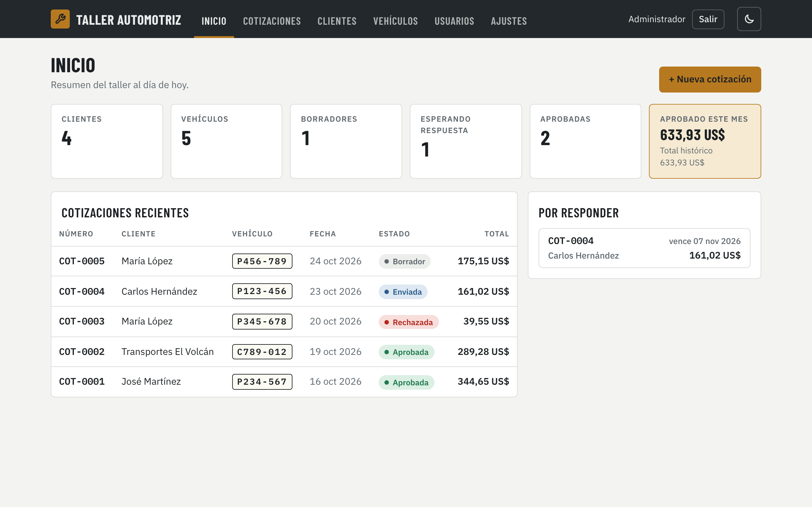
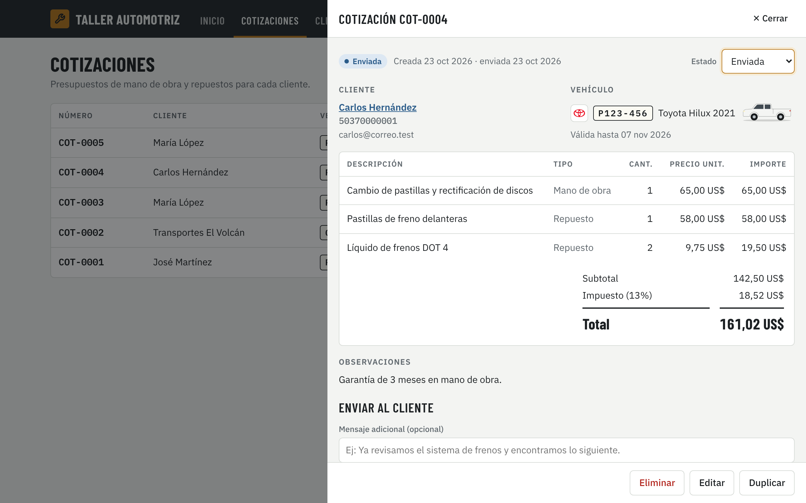
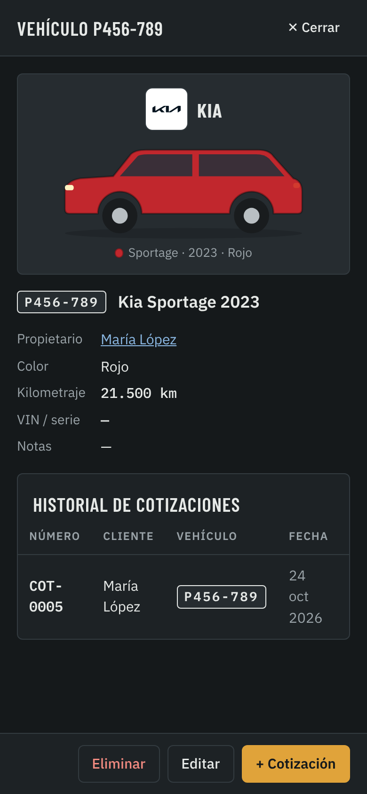

# Taller — Gestión de taller mecánico

Aplicación web para administrar un taller: usuarios con roles, clientes, vehículos y
cotizaciones que se envían al cliente por correo o WhatsApp para que las apruebe en línea.

## Capturas

Versión web con Firebase ([`web/firebase/`](web/firebase/README.md)), con datos de ejemplo.

**Inicio**: resumen del taller y cotizaciones recientes.



**Cotización**: detalle de mano de obra y repuestos, totales con impuesto y envío al cliente.



**Vehículo en el celular (modo oscuro)**: logo de la marca y silueta pintada del color del vehículo.



## Versiones

| Carpeta | Qué es |
| --- | --- |
| [`web/firebase/`](web/firebase/README.md) | Web instalable (PWA) con inicio de sesión y datos en Firebase. Es la versión en uso. |
| [`web/taller.html`](web/taller.html) | La misma web como página de claude.ai, con datos guardados en claude.ai. |
| `src/`, `public/` | Aplicación Node.js + SQLite descrita abajo, para un servidor propio. |

## Funcionalidades (aplicación Node.js)

- **Usuarios y roles**: el primer acceso crea la cuenta de administrador. El administrador crea usuarios
  con rol *Administrador*, *Recepción* o *Mecánico* y puede desactivarlos.
- **Clientes**: datos de contacto, documento, notas, vehículos y cotizaciones de cada uno.
- **Vehículos**: placa, marca, modelo, año, color, kilometraje y VIN, con historial de cotizaciones.
- **Cotizaciones**: ítems de mano de obra, repuestos u otros; descuento, impuesto, validez y observaciones.
  Numeración automática (`COT-00001`) y estados *Borrador → Enviada → Aprobada / Rechazada*.
- **Envío al cliente**:
  - enlace público (`/c/<token>`) donde el cliente ve la cotización y la **aprueba o rechaza**;
  - **correo electrónico** (si se configura SMTP) o con el programa de correo del usuario;
  - **WhatsApp** con el mensaje y el enlace ya escritos.
- Impresión / PDF desde el navegador, panel de inicio con resumen y ajustes del taller (nombre, moneda, impuesto…).

## Requisitos

- Node.js **22.13 o superior** (usa el módulo integrado `node:sqlite`, no requiere instalar una base de datos).

## Uso

```bash
npm install
npm start          # http://localhost:3000
```

Abre el navegador, crea la cuenta de administrador y empieza a registrar clientes.
Los datos se guardan en `data/taller.db`.

## Configuración (variables de entorno)

| Variable | Descripción |
| --- | --- |
| `PORT` | Puerto HTTP (por defecto `3000`). |
| `DB_FILE` | Ruta del archivo SQLite (por defecto `data/taller.db`). |
| `PUBLIC_URL` | URL pública del sitio, usada en los enlaces que se envían a los clientes (ej. `https://taller.midominio.com`). |
| `SECURE_COOKIES` | `true` si el sitio se sirve con HTTPS. |
| `TRUST_PROXY` | Valor de `trust proxy` de Express si está detrás de un proxy (ej. `1`). |
| `SMTP_HOST`, `SMTP_PORT`, `SMTP_SECURE`, `SMTP_USER`, `SMTP_PASS`, `SMTP_FROM` | Servidor de correo para enviar cotizaciones por email. Sin `SMTP_HOST` el envío directo por correo se desactiva. |

Ejemplo con Gmail (requiere una *contraseña de aplicación*):

```bash
SMTP_HOST=smtp.gmail.com SMTP_PORT=465 SMTP_SECURE=true \
SMTP_USER=mitaller@gmail.com SMTP_PASS=xxxx SMTP_FROM="Mi Taller <mitaller@gmail.com>" \
PUBLIC_URL=https://taller.midominio.com npm start
```

> Para que los clientes puedan abrir el enlace de la cotización, el servidor debe ser accesible desde internet.

## Pruebas

```bash
npm test
```

## Estructura

```
src/
  server.js   arranque del servidor
  app.js      API REST (Express)
  db.js       esquema SQLite
  auth.js     contraseñas (scrypt) y sesiones
  quotes.js   cálculo de totales y plantilla del correo
  mailer.js   envío de correo (nodemailer)
public/
  index.html, app.js, styles.css   aplicación del taller
  cotizacion.html                  vista pública de la cotización para el cliente
test/         pruebas de la API
```
